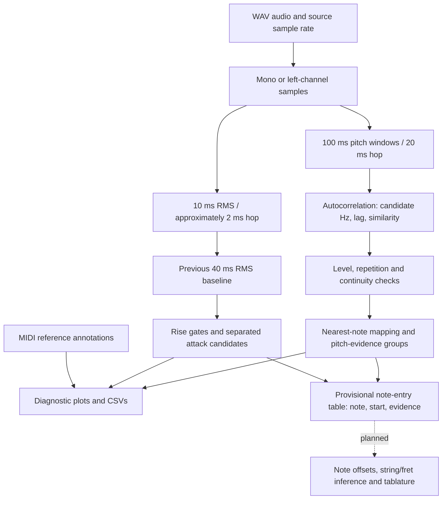
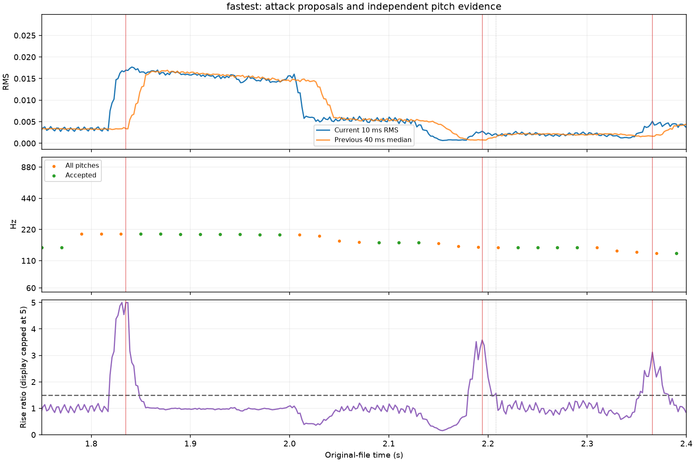

# Signal processing and validation

[Back to the project overview](../README.md) · [Experiment guide](experiments.md)

Implementation details for the current DSP baseline. These components produce
pitch evidence, attack proposals, and provisional note-entry tables; complete
transcription remains planned. The newest integration is described below.

## Current event integration

`event_detection.py` combines existing rise proposals and quieter changed-pitch
entries with pitch groups. `note_event_pipeline.py` runs it on outputs from 08,
producing CSV/Markdown tables and an evidence audit. Each pitch group retains a
row; nearby cues merge into one entry, and internal rises propose flagged repeats.
Start association uses the 100 ms pitch-window duration. Rise timing takes
precedence over drop timing, with reasons preserved. Ends remain unknown.
This adds a reviewable table, not validated transcription: baseline's extra D3
rise still creates a flagged repeat, and wrong pitch groups remain visible.
The diagram/methods below describe the preceding independent measurement stages;
the joint entry stage is now implemented, while note offsets and tabs are planned.

## Technical architecture



The computational modules accept arrays or measurement rows; experiment scripts
own file selection, parameters, plotting, and exports. Pitch acceptance currently
lives in several experiment scripts rather than a unified application API.
MIDI is a comparison layer, not an input to the pitch estimator or attack detector.

| Code | Responsibility |
| --- | --- |
| [`pitch_analysis.py`](../pitch_analysis.py) | `estimate_period`: single-window frequency, integer lag, and similarity |
| [`attack_analysis.py`](../attack_analysis.py) | `measure_energy_rise` and `detect_attack_candidates`: measurements and auditable proposals |
| [`note_events.py`](../note_events.py) | `group_pitch_windows`: nearest-note evidence runs, preserving rejected/missing-window gaps |
| [`guitartechs_midi.py`](../guitartechs_midi.py) | `read_note_labels`: tempo-aware note pairing and string-track metadata |
| [`compare_recordings.py`](../compare_recordings.py) | Earlier first-onset alignment and equal-duration amplitude comparisons |

The numbered notebooks and corresponding scripts are experimental clients of
these components. Their questions, inputs, and run order are indexed in
[the experiment guide](../docs/experiments.md). There is no packaged transcription
CLI or application service yet.

## Technical methods

### Fundamental frequency through autocorrelation

For a window of length $N$, subtract its mean to obtain $y[n]$. The estimator
explicitly computes overlapping products at each lag $k$:

$$
\rho(k)=\frac{\sum_{n=0}^{N-k-1}y[n]y[n+k]}{\sum_{n=0}^{N-1}y[n]^2},\qquad
\hat f_0=\frac{f_s}{k^*}.
$$

The selected $k^*$ is the highest positive local maximum inside the lag range
corresponding to 60–1,000 Hz by default. Constant windows or windows with no
positive local peak return NaNs; invalid inputs raise errors. This is a direct
NumPy implementation, not a call to a pretrained pitch model.

A guitar waveform contains a fundamental and approximately integer-multiple
harmonics. A strong second harmonic can make the largest FFT peak suggest an
octave above the played note. Autocorrelation examines waveform repetition, but
competing periods can still produce octave errors or stable incorrect pitches.
Integer lags limit frequency resolution. Normalizing by full-window energy
also favors shorter lags because longer shifts have fewer overlapping pairs.
**Similarity measures repetition, not the probability that a note is correct.**

The [spectral experiment](../02_understanding_frequency.ipynb) uses mean removal,
a Hann window, and a real FFT to inspect these ambiguities. FFT bin spacing is
$f_s/N$; it is not an accuracy guarantee. The pitch estimator itself does not
apply that Hann window.

### Pitch checks and note names

Current tracking experiments require RMS at least three times a selected
background reference, similarity at least 0.80, and two adjacent eligible
windows whose estimates differ by at most 50 cents:

$$
\Delta c=1200\left|\log_2\left(\frac{f_t}{f_{t-1}}\right)\right|.
$$

Accepted frequencies map to equal-tempered MIDI note numbers using A4 = 440 Hz:

$$
m=\left\lfloor69+12\log_2(f/440)+0.5\right\rfloor.
$$

Consecutive accepted windows with the same note number form evidence groups.
Rejected or missing windows split groups. This preserves uncertainty but can
fragment a note; uninterrupted same-pitch re-picking can merge. Note naming
already exists. Accurate musical event boundaries and fingering do not.

### RMS and attack detection

$$
\operatorname{RMS}(x)=\sqrt{\frac{1}{N}\sum_{n=0}^{N-1}x[n]^2}.
$$

RMS describes digital amplitude, not perceived loudness. For each current 10 ms
window with RMS $r_t$, the attack detector compares it with $b_t$, the median RMS
of four preceding nonoverlapping 10 ms blocks. With positive background reference
$q$, the initial gates are:

$$
r_t\ge3q,\qquad \frac{r_t}{\max(b_t,q)}\ge1.5,\qquad r_t-b_t\ge3q.
$$

The reference floor prevents a ratio against zero or negligible history from
being treated as sufficient evidence. Consecutive qualifying frames form an
episode, represented by its largest RMS rise. Strongest-first suppression keeps
candidate peaks at least 80 ms apart. All episodes retain selection or
suppression reasons.

These are explicit heuristics, not learned thresholds. A soft pick after a loud
note may produce little relative rise; handling noise can pass. Suppression
uses future candidates and can discard closely spaced real attacks. Peak
midpoints are approximate markers, not sample-exact physical onsets. The older
first-onset detector in `compare_recordings.py` is a separate algorithm with a
quiet-first-0.5-seconds assumption; the new detector does not assume that lead-in.

### Windows, timing, and preprocessing tradeoffs

Pitch experiments use 100 ms windows with 20 ms hops. At 44.1 kHz these contain
4,410 samples and advance 882 samples. Shorter windows follow transitions more
closely but contain fewer periods of low notes; longer windows can mix notes.
An overlapping hop is not equivalent to onset timing precision.

Energy measurements use 10 ms windows and nominal 2 ms hops. At 44.1 kHz the hop
rounds to 88 samples (about 1.995 ms), so timestamps derive from actual sample
indices. Incomplete final windows are dropped. Pitch windows are mean-centered;
RMS uses the original signal, so offsets can affect level checks. Current personal
recording runs use a manually selected, provisional shared background reference;
gain consistency is not established. Raw and accepted estimates remain visible.

## Validation and testing

Run the standard-library test suite from the repository root:

```bash
python -m unittest discover -v
```

**32 tests passed on Python 3.13.9 during the documentation audit.** Coverage includes:

- Known synthetic pitches at 44.1/48 kHz, stronger second harmonics, gain/DC-offset
  invariance, constant signals, and invalid inputs.
- RMS arithmetic, original sample bounds, partial windows, onset alignment,
  and calibrated gain scaling.
- Renewed excitation without a silence gap, decaying-tone controls, zero
  baselines, candidate consolidation, and missing measurements.
- Note grouping across pitch changes and rejected windows; labels are ignored
  by grouping. MIDI tests cover tempo changes, track identity, and invalid pairing.

These tests establish algorithmic behavior, **not transcription accuracy**.
Real-recording checks use included personal WAVs and separately downloaded
Guitar-TECHS audio/MIDI. Overlapping windows are not independent observations,
and inspected recordings are development examples rather than a held-out test set.

A concrete limitation from the fastest personal take: pitch changes from G3 to
E3 near 2.05 seconds while RMS falls. The amplitude-rise rule produces no attack
candidate for that transition. Matching a recording's total note count would
not reveal such a miss if an extra candidate appeared elsewhere.



*Red lines are selected attack candidates, green points are accepted pitch
estimates, and the bottom curve is the rise ratio (display capped at 5).
This is an actual generated diagnostic, not a benchmark score. See
[experiment 09](../09_detecting_attacks.ipynb) and [figure provenance](../docs/experiments.md#published-diagnostic).*

